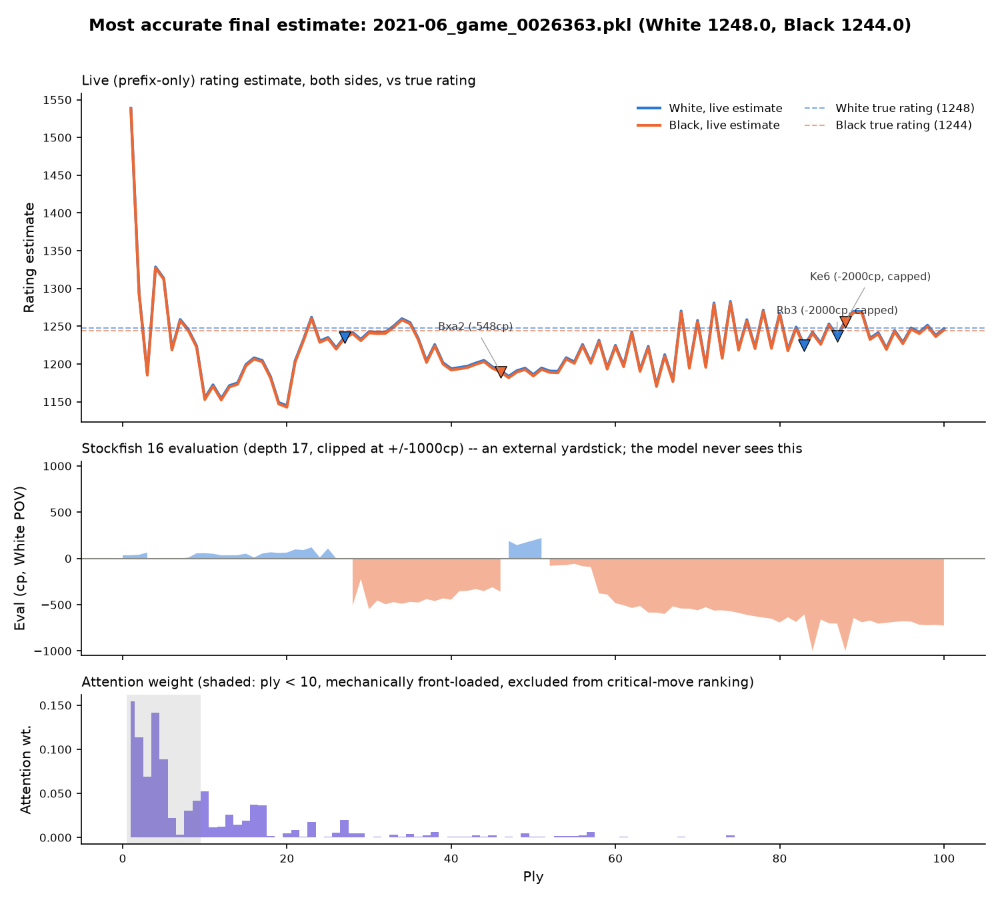
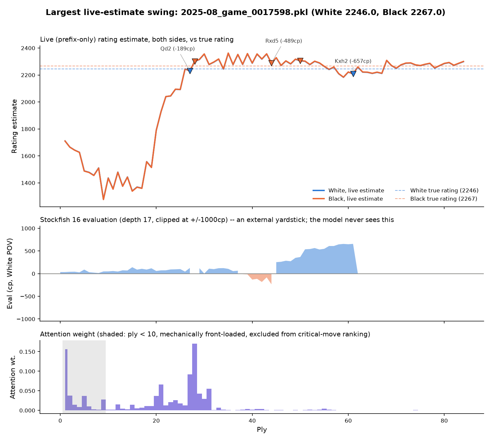

# Move-level explanation of the rating estimate

Written 2026-10-11 for the pre-oral defense on 2026-10-15, at the thesis consultant's
request: why the model's rating estimate rises or falls at particular moves,
interpreted through engine evaluation, position, and clock. Method, sample, and
numbers below; case-study figures and a small per-ply JSON for each are in
`analysis/figures/` and `analysis/move-explanation-data/`.

**The model never sees an engine.** It is trained only on board positions, moves,
and clock times. Every Stockfish number in this note, in the figures, and in the
JSON files is an external yardstick used here only to interpret the model's
estimate after the fact. The model cannot and does not use it.

## Method

**"Live" means the prefix-recompute estimate the prototype actually shows**, not
the offline bidirectional per-ply output. The served model's BiLSTM is not
incremental (see `src/live.py`): scoring ply *t* live means re-running the whole
model on plies `1..t` and keeping only that final ply's output. This note recomputes
that quantity directly, with the same forward-pass code path (`analysis/move_explanation_curves.py`),
one call per prefix length. Before trusting it at scale, the script reconstructed PGN
prefixes for 3 sampled games at several ply checkpoints and called the prototype's own
`src.api._run_inference` on each one: the two agreed to within 0.005 rating points at
every checkpoint tested (`analysis/move-explanation-data/curves-equivalence-check.json`),
which is floating-point rounding, not a different computation. The live curve's value at
the final ply is, by construction, the same forward pass as the offline full-game pass,
so the case-study figures' attention weight (a property of one forward pass) is read from
that pass without ambiguity.

**Two checkpoints.** The served model (`attn_tuned`, sha256 `ff6370e4...6124275a0`,
matches the hash published in the top-level README) has nearly identical White and
Black estimates within a game (median final-ply gap 0.72 rating points across the
3,000 sampled games here, consistent with the project's documented 0.71-point figure
on the full 255,000-game test set). Per the task brief, `mirror_arm_a_gapweight`
(same architecture, gap-weighted training loss, sha256 `97ffa6e7...ebcfd77c0481`,
passed the pre-registered criterion (a) accuracy check in
`analysis/mirror-retrain-results.md`) is run alongside it for comparison, since its
sides do separate (median final-ply gap 16.2 rating points here). Both checkpoints
were loaded by building `ChessEloPredictor` from each checkpoint's own stored
`params` (matching `src/api.py`'s own loading logic) and asserting zero missing
state-dict keys outside the parameter-free `anomaly_detector` module; neither
checkpoint's weights were modified.

**Engine evaluation.** Stockfish 16, depth 17, 1.0-second-per-position cap, single
thread, deterministic hash size, one `analyse` call per position (not per move):
evaluating positions `0..T` of a `T`-ply game and taking consecutive differences
gives both the before/after evaluation and the centipawn loss of each move,
without a second engine call
(`analysis/move_explanation_engine.py`). Mate scores are capped at 10,000 cp before
differencing; centipawn loss is capped at 2,000 cp per move.

## Sample

A fixed, seeded sample of 3,000 games from the frozen 255,000-game TEST partition
(`sample_seed=20261011`, drawn with `analysis/sample_test_games.py` against
`data/split_manifest_2p55M_seed42.json`, `manifest_sha256=dee7d117...bd9ed2b3b`,
matching the value recorded in `analysis/mirror-retrain-preregistration.md`).
Games are truncated at 100 plies, the same cap the served prototype itself uses
(`api.MAX_PLIES`). 2,992 of the 3,000 sampled games yielded at least 3 plies of
usable data (the rest were excluded only by that minimum-length filter, not by any
engine or model failure: the Stockfish pass completed all 3,000 games with zero
errors). After dropping each game's first ply (no earlier estimate to diff
against), the per-ply dataset is 185,058 rows; 182,066 of those also have a usable
time-spent figure (see Limitations). Full reproduction commands are in
`analysis/run_move_explanation.sh`; raw per-game curves and the per-ply CSV used
for the regression below are not committed (same convention as this repository's
other large per-game CSVs), but are reproducible from the committed scripts, the
committed sample, and the HPC run log quoted in
`analysis/move-explanation-data/engine-run-meta.json`.

## What does the live estimate's change actually track?

For every ply after the first, the change in the live estimate from the previous
ply was regressed on: the ply band (six bands, 1-10 through 81-100), the game's
time-control bucket, who moved, the square-root of that move's Stockfish centipawn
loss, the signed White-POV evaluation change caused by the move, and (in a second
model, on the subset with a usable time figure) the capped time spent on the move.
Confidence intervals are a 1,000-resample **cluster bootstrap over games**, not
over plies: plies within a game are not independent, so a per-ply bootstrap or
per-ply OLS standard error would be far too narrow given roughly 62 plies per
game. Four response variables are reported per checkpoint: the mover's own
estimate change, the opponent's, the mean of both, and the own-minus-opponent
difference (the one response where a per-side effect, if present, would show up
most directly).

**Headline: the relationship is real but small, and time spent tracks the live
estimate more than engine-measured move quality does.** Adding
centipawn-loss and signed-eval-change to the ply/time-control/mover baseline moves
R-squared by only 0.0001 to 0.0007 across every response and both checkpoints;
adding time spent on top moves it by roughly 0.01 for the served model's
own/opponent/mean responses, about 40 times the move-quality contribution. None of
this explains much of the live estimate's ply-to-ply movement in absolute terms
(R-squared stays under 0.03 everywhere except the one response discussed below),
which is itself the honest finding: most of what moves the live curve from one ply
to the next is not captured by engine-measured move quality, time spent, or coarse
game phase.

| Checkpoint | Response | R2, ply+TC+mover only | R2, + move quality | R2, + time spent |
| --- | --- | --- | --- | --- |
| served | own | 0.0047 [0.0038, 0.0059] | 0.0050 [0.0041, 0.0062] | 0.0148 [0.0135, 0.0165] |
| served | opponent | 0.0047 [0.0038, 0.0059] | 0.0050 [0.0040, 0.0061] | 0.0148 [0.0135, 0.0165] |
| served | mean | 0.0047 [0.0038, 0.0059] | 0.0050 [0.0040, 0.0061] | 0.0148 [0.0135, 0.0165] |
| served | own minus opponent | 0.0058 [0.0045, 0.0077] | 0.0059 [0.0046, 0.0078] | 0.0045 [0.0037, 0.0060] |
| mirror_arm_a | own | 0.0102 [0.0074, 0.0140] | 0.0107 [0.0078, 0.0144] | 0.0231 [0.0200, 0.0274] |
| mirror_arm_a | opponent | 0.0082 [0.0057, 0.0115] | 0.0082 [0.0058, 0.0116] | 0.0211 [0.0178, 0.0258] |
| mirror_arm_a | mean | 0.0022 [0.0018, 0.0029] | 0.0025 [0.0020, 0.0032] | 0.0145 [0.0131, 0.0163] |
| mirror_arm_a | own minus opponent | 0.1332 [0.0862, 0.2007] | 0.1339 [0.0866, 0.2017] | 0.1389 [0.0903, 0.2080] |

Full coefficients and CIs for every term are in
`analysis/move-explanation-data/regression-results.json`.

**Costlier moves do move the estimate down, by a small but statistically
non-zero amount, and for the served model that movement is shared almost equally
by both sides.** Holding ply band, time control, and mover fixed, a doubling of
`sqrt(centipawn loss)` is associated with a fall of about 0.11 rating points (95%
CI roughly [-0.13, -0.09]) in the served model's own, opponent, and mean estimate
changes alike; the three coefficients agree to three decimal places. The
own-minus-opponent version of the same coefficient is two orders of magnitude
smaller (0.0002, CI [0.0001, 0.0003]) than the own/opponent coefficient, so even though it
is technically distinguishable from zero at this sample size, it carries almost no
practical per-side information: a costly move moves the whole game-level estimate,
not one player's estimate relative to the other's. This is exactly what the
served model's near-equal White/Black estimates would predict.

**`mirror_arm_a_gapweight`, whose sides do separate, shows a real per-side
effect that the served model does not.** Its own-minus-opponent coefficient on
`sqrt(centipawn loss)` is -0.083 (95% CI [-0.11, -0.05]): a costlier move by the
mover is associated with the mover's own estimate falling relative to the
opponent's, in the expected direction, at a magnitude the served model's
own-minus-opponent response does not show.

**Time spent on a move tracks the live estimate more strongly than move quality
does, in the opposite direction from what intuition about "careful play" might
suggest.** Holding the other covariates fixed, more time spent (capped at 120
seconds) on a move is associated with a *fall* in the own, opponent, and mean live
estimate for both checkpoints, roughly -0.6 to -0.8 rating points per additional
capped second (every CI excludes zero). One plausible reading, not tested further
here, is that harder or more unclear positions both take longer to think about and
coincide with lower estimates for reasons unrelated to the thinking time itself;
this is a correlational result, not a causal one.

**Robustness: the two headline effects hold, and slightly strengthen, when
decided positions are excluded.** Restricting to the 163,886 rows with
|evaluation before the move| under 700 centipawns (88.6% of the scored rows), the
served model's mean-response `sqrt(centipawn loss)` coefficient moves from -0.107
[-0.129, -0.085] to -0.137 [-0.167, -0.100], and `mirror_arm_a`'s
own-minus-opponent coefficient moves from -0.083 [-0.114, -0.052] to -0.125
[-0.156, -0.091]. Full numbers in
`analysis/move-explanation-data/robustness-decided-subset.json`.

**Game phase**, used here as the ply band plus a material-based opening/
middlegame/endgame split in the engine pass, is folded into the baseline model
above rather than treated as a free-standing predictor: it is confounded with ply
by construction, and the baseline model's own small R-squared values (0.002 to
0.013 across responses, before move quality or time are added) already show that
knowing only the ply band, time control, and who moved explains little of the
estimate's ply-to-ply movement on its own.

## A caveat the figures below depend on: attention is front-loaded by construction

The served model's attention weight, averaged over 3,000 games, is about 0.15 at
ply 1 and about 0.0001 by ply 90. This is not evidence that opening moves matter
50 times more than late-game moves to the model's skill assessment. The causal
attention mask makes an early ply a valid attention key for nearly every later
query, while a late ply is valid for almost no query (it is only ever queried by
positions at or after it), so early plies are averaged over far more nonzero
contributions regardless of their learned weight. `src/critical_moves.py` already
works around this by excluding plies before `DEFAULT_MIN_PLY` (10) from its
attention-ranked critical-move list; the case-study figures below shade that same
region and the written interpretation below does not read anything into the
shaded ply 1-9 attention values.

## Case studies

Two TEST games, picked by a rule fixed before plotting (not cherry-picked
afterward), among the 2,408 sampled games with at least 40 plies:

- **Most accurate**: the smallest final-ply mean |live estimate - true rating|
  across both sides.
- **Largest swing**: the largest (max - min) of the mean-of-both-sides live
  estimate, restricted to plies after 15 so opening volatility (see the
  attention caveat above) cannot win this by construction alone.

Both figures show, top to bottom, sharing a ply axis: the live (prefix-only)
rating estimate for both sides against the true pre-game rating; the Stockfish
evaluation track in White's point of view (the model never sees this, only shown
as a yardstick); and the model's own attention weight, with the mechanically
front-loaded ply 1-9 region shaded. Markers on the top panel mark the five
highest centipawn-loss moves at ply 10 or later; the three largest are labeled.
Per-ply JSON for both games (rating, evaluation, centipawn loss, phase,
attention) is at `analysis/move-explanation-data/case-accurate.json` and
`case-swing.json`.

### Most accurate: `2021-06_game_0026363.pkl` (White 1248, Black 1244)



Final-ply mean absolute error 1.14 rating points across both sides, over 100
plies. White and Black's live curves track each other almost exactly throughout
(consistent with the served model's near-zero median White/Black gap), swinging
widely in the first 20 plies (1540 down to 1145) before settling into a
tighter band around the true rating from about ply 35 onward. The two
largest-centipawn-loss moves in the game, `Ke6` and `Rb3` (both capped at the
2,000 cp ceiling, i.e. a lost/winning position thrown into something close to the
opposite), sit inside that already-settled late-game region and produce no
visible jump in the live curve: consistent with the aggregate finding that
engine-measured move quality is a weak driver of the live estimate's movement.
What does coincide with the curve's movement is ply: the largest swings are in
the first 10 to 20 plies, where attention (bottom panel) is also at its highest,
mechanically, by construction.

### Largest swing: `2025-08_game_0017598.pkl` (White 2246, Black 2267)



The live estimate falls from about 1710 to about 1290 over the first 18 plies,
then climbs sharply to above 2300 by around ply 28 and stays near the true rating
(2246 to 2267) for the rest of the game: a swing of just over 1,000 rating points,
the largest in the sampled 3,000 games. The single largest centipawn-loss move
in the game is `Kxh2` at ply 61 (White's king recaptures into what turns out to be
a drawn-by-repetition queen check sequence, throwing away a position Stockfish had
at +657 centipawns for White down to a dead-equal 0): a real, sizeable blunder by
the engine's own measure, in exactly the kind of position this note's regression
says centipawn loss barely moves the live estimate, and the live curve agrees:
there is no visible drop in the rating estimate at ply 61. The estimate's one
large, sustained move happens earlier, between roughly ply 18 and ply 28, in the
region the attention panel also marks as mechanically highest-weighted; nothing in
the centipawn-loss or evaluation tracks at those plies stands out as unusually
large. Both case studies point the same way: what moves this model's live
estimate is concentrated early in the game, not obviously tied to how costly a
move was by engine measure, which matches the aggregate regression's small
move-quality R-squared.

## Limitations

- **This is a correlational analysis of one trained checkpoint pair**, not a
  causal claim about what the model "uses." The regression's R-squared values are
  small throughout; most of the live estimate's ply-to-ply movement is not
  explained by any predictor used here.
- **Time-spent is unreliable for each side's first move** (ply 1 and ply 2):
  `compute_time_spent` falls back to the `TimeControl` base allotment there, which
  berserk (a Lichess feature that halves a player's own clock) can make
  meaningless; those two plies per game are dropped from every time-spent figure,
  and negative values (observed occasionally, likely from increment or lag
  edge cases) are clipped to zero rather than guessed at further.
- **Centipawn loss is capped at 2,000** and the underlying evaluation at 10,000
  (mate scores), so a handful of the largest blunders in the sample are recorded
  as tied rather than ranked against each other; this affects labeling in the case
  studies (see `Ke6`/`Rb3` above) more than the regression, where the centipawn-loss
  cap binds for 2.1% of scored plies and the evaluation (mate) cap for 4.4%.
- **Stockfish search depth is a race against a 1-second-per-position cap**, not a
  guaranteed fixed depth; `analysis/move_explanation_engine.py` records the depth
  actually reached per position for exactly this reason, though this note does
  not further stratify by it.
- **Attention weight, read only past ply 10 per the caveat above**, is still a
  property of one trained checkpoint's one attention mechanism, not a general
  claim about what "matters" in a position.
- **The regression's move-quality and time-spent effect sizes are both small
  relative to the live estimate's overall ply-to-ply volatility** (standard
  deviation around 55 rating points for the served model's own-estimate change);
  the case studies above are illustrations of the aggregate pattern, not
  independent evidence for it.
- **`mirror_arm_a_gapweight` is a gap-weighted training loss on the same shared
  architecture**, not a separate-heads model (that is the different, and
  pre-registration-failing, `mirror_arm_b_diffhead` arm); its larger
  own-minus-opponent separation comes from training emphasis on wide-gap games,
  not an architectural change, and it is not the served model.

## Reproduction

HPC work ran under `~/thesis2/scratch/move_explain/` (never `~/thesis2` itself),
on GPU 2 (GPUs 0 and 1 left untouched), in tmux session `fm_holder` so the
training watchdog's `--experiment` substring match could not mistake this
analysis run for a training run. Commands:

```
cd ~/thesis2
python3 analysis/sample_test_games.py \
  --manifest data/split_manifest_2p55M_seed42.json \
  --n 3000 --seed 20261011 --out scratch/move_explain/out/sample_games_3000.json

bash analysis/run_move_explanation.sh   # launches both the GPU curve job and the
                                         # CPU Stockfish job, writes .DONE/.FAILED
                                         # markers under scratch/move_explain/out/
```

Then locally: `analysis/move_explanation_merge.py` (builds the per-ply table from
the two HPC outputs), `analysis/move_explanation_regression.py` (the bootstrap
regression above), `analysis/move_explanation_case_studies.py` (selects the two
games and renders the figures and per-ply JSON in this note).
